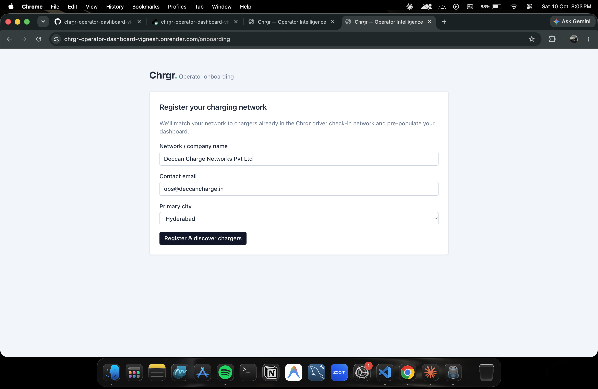
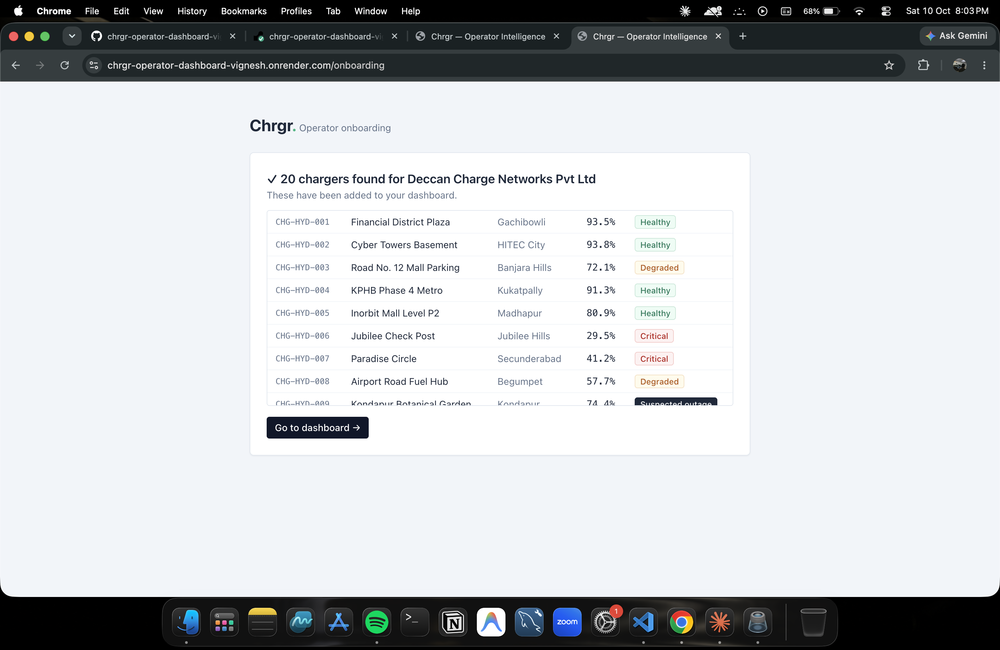
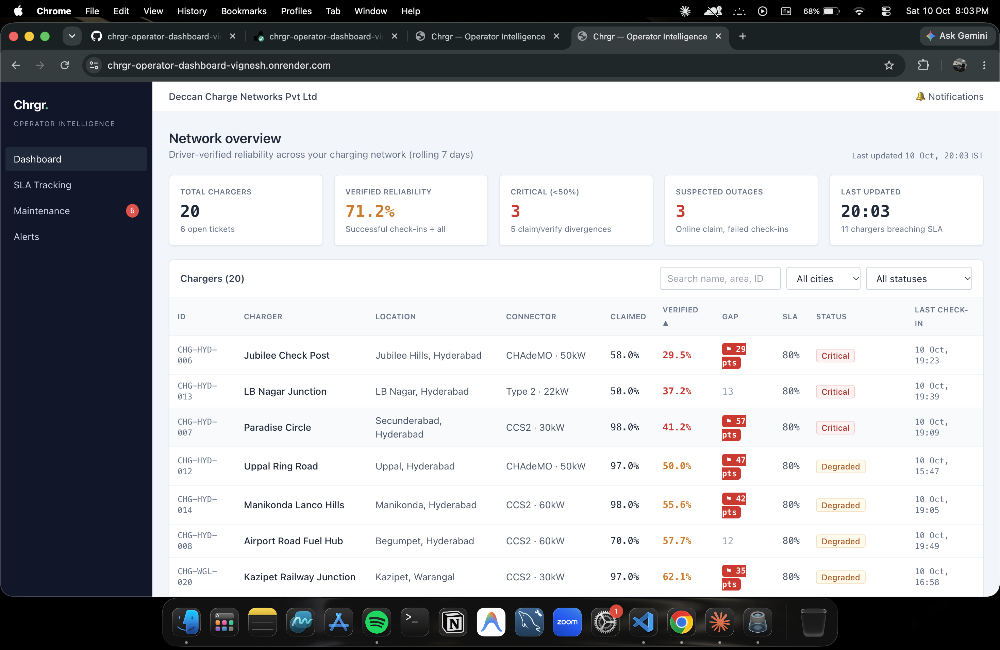
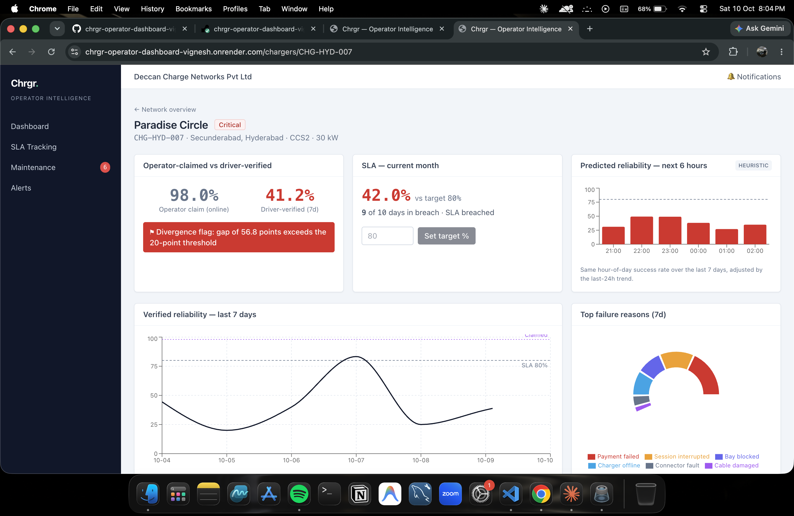
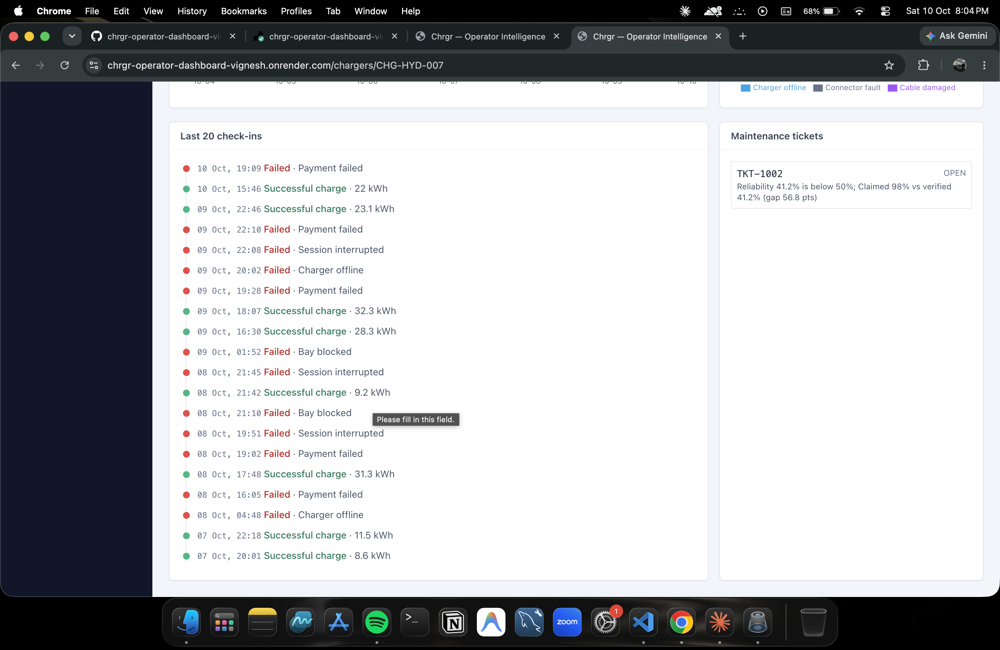
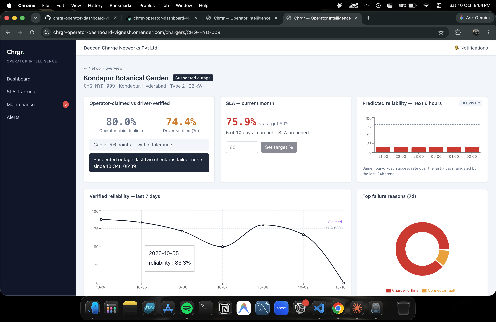
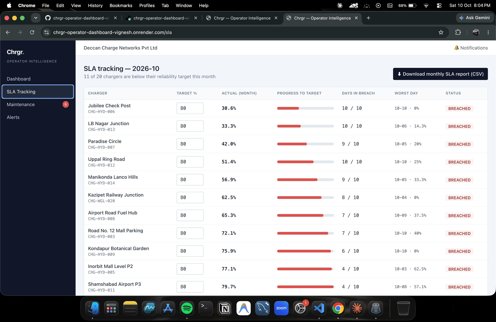
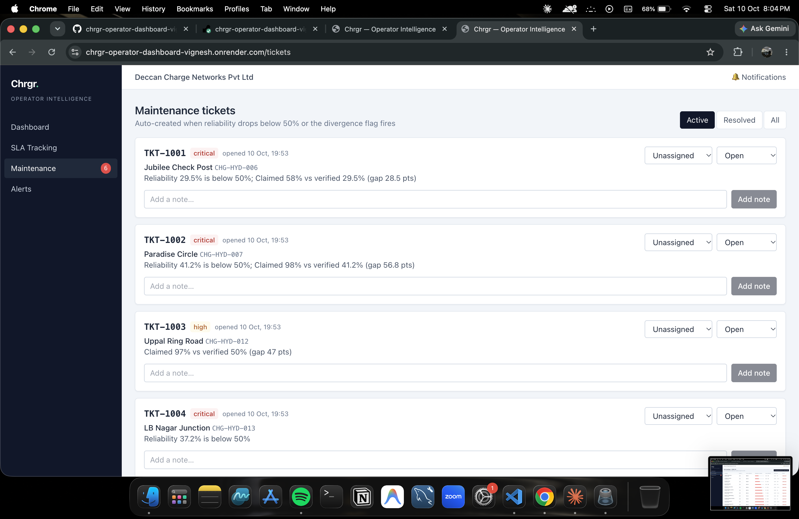
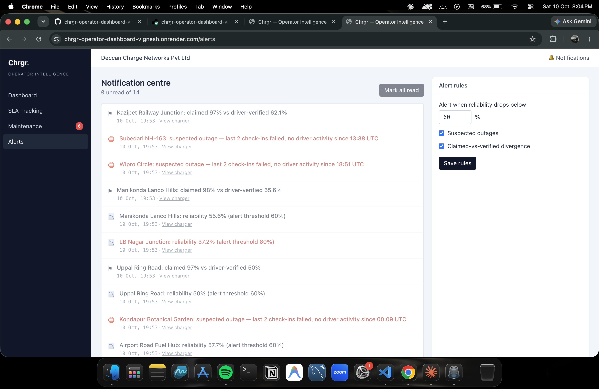

# Chrgr — Operator Intelligence Dashboard & Uptime SLA System

Independent, driver-verified reliability for EV charging operators in India. Operators self-report charger status today; Chrgr compares that claim with what drivers actually experienced and turns the gap into SLAs, tickets and alerts.

**Live demo:** https://chrgr-operator-dashboard-vignesh.onrender.com _(free tier — the first load after idle can take ~30–60 s)_  ·  **Stack:** React (Vite) + Tailwind CSS + Recharts · Node.js/Express · in-memory store

## Run locally
```bash
npm install            # server deps
npm run seed           # (optional) regenerate mock_chargers.json
cd client && npm install && cd ..
npm start              # API on :4000
npm run dev:client     # UI on :5173 (proxies /api to :4000)
```
Production: `npm install && npm run build && npm start` — Express serves the built React app, so there is one URL and no CORS.

## Architecture
Check-ins are the **single source of truth**. `server/seed.js` generates 30 days of driver check-ins for 20 chargers (16 Hyderabad, 4 Warangal) into `mock_chargers.json`. Reliability, trends, divergence, SLA breach days, tickets, alerts and predictions are all computed from them in `server/compute.js`, so every screen stays consistent.

## Assumptions & definitions
| Concept | Definition |
|---|---|
| Reliability | Successful check-ins ÷ total check-ins over a rolling 7 days (a Successful Charge Attempt Rate, as in California's 90% rule) |
| Critical | Reliability below 50% |
| Divergence flag | \|operator-claimed uptime − driver-verified reliability\| > 20 points |
| Suspected outage | Operator claims "online", last two check-ins failed, and no check-in for 6+ hours |
| SLA | Per-charger target (default 80%); actual = verified reliability over the current calendar month (IST); a day is "in breach" if that day's reliability is below target |
| Prediction (6h) | **Heuristic, not ML:** same hour-of-day success rate over the last 7 days, smoothed toward the 7-day average, nudged by the last-24h trend; capped at 15% during a suspected outage |
| Auto-ticket | After every refresh, a ticket is created if reliability < 50% or divergence fires and the charger has no open ticket |
| Recovery | A resolved ticket is "confirmed" once 3+ check-ins arrive after resolution at or above the SLA target |

Other notes: data is mock; timestamps are shifted at server start so the dataset always ends "now". State (tickets, alerts, targets) is in memory and resets on restart. Days with very few check-ins can be noisy.

## Screens

### 1. Operator onboarding
New operators register their network (name, contact email, primary city).



After registering, the network's chargers are discovered and pre-populated, listed with their current driver-verified reliability.



### 2. Operator dashboard
Five summary cards (total chargers, driver-verified reliability, critical count, suspected outages, last updated) and a sortable, filterable table of all 20 chargers. A red flag marks chargers where claimed vs verified uptime differs by more than 20 points.



### 3. Charger detail — divergence flag
Operator-claimed vs driver-verified status with the red divergence flag, month-to-date SLA position with an editable target, a heuristic 6-hour reliability prediction, the 7-day trend against the SLA target and claimed uptime, and a donut of top failure reasons.



The last 20 driver check-ins as a timeline, with the charger's linked maintenance ticket.



### 4. Charger detail — suspected outage
A charger that still claims to be online but whose last two driver check-ins failed with no activity since. The prediction is capped at a low value while an outage is suspected.



### 5. SLA tracking
Per-charger reliability targets (default 80%, editable), month-to-date actual, progress to target, days in breach, worst day, and a downloadable CSV report.



### 6. Maintenance tickets
Tickets are auto-created when reliability falls below 50% or the divergence flag fires. Operators assign technicians, change status and add notes.



### 7. Notification centre
Configurable alerts for reliability drops, suspected outages and divergence, with read/unread state.



## API
`GET /api/summary` · `/chargers` · `/chargers/:id` · `PUT /chargers/:id/sla-target` · `GET /sla` · `/sla/report.csv` · `GET/PATCH /tickets` · `POST /tickets/:id/notes` · `GET /alerts` · `PUT /alert-config` · `POST /onboarding`
